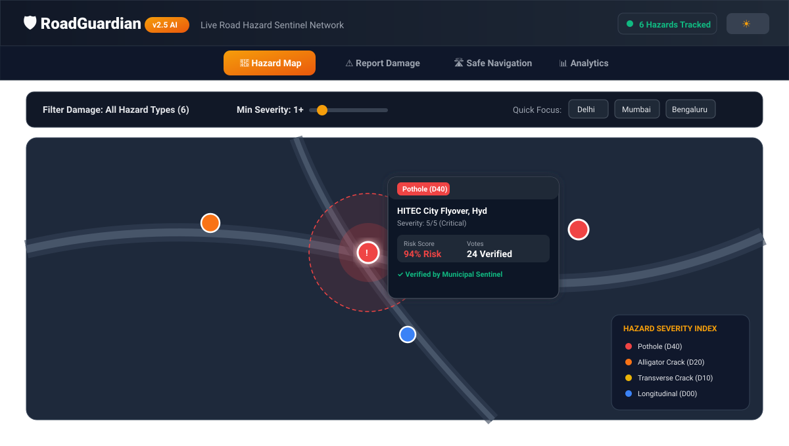
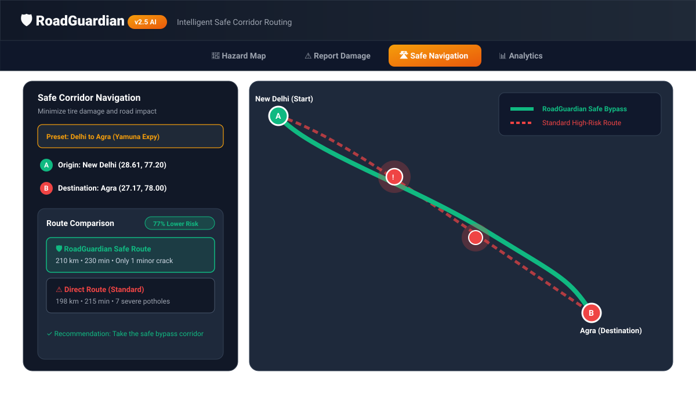
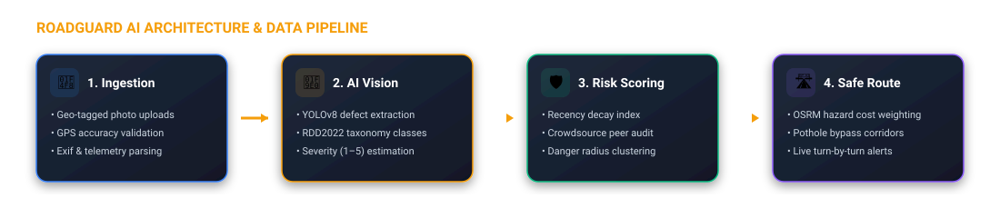

# RoadGuardian 🛡️

[](https://github.com/PoornaSri26/RoadGuard/actions/workflows/deploy.yml)
[](https://github.com/PoornaSri26/RoadGuard)
[](LICENSE)

> **AI-Powered Road Damage Detection & Intelligent Safe-Corridor Navigation**

RoadGuardian is an open-source, community-driven road intelligence platform that fuses computer vision (YOLOv8 trained on the RDD2022 dataset) with spatial graph routing (OSRM). It detects road structural defects, calculates multi-factor road risk scores, and routes vehicles along damage-avoiding corridors to preserve tires, suspensions, and passenger safety.

---

## 📸 Platform Previews & Visual Results

### 1. Interactive Hazard Map & Real-Time Sentinel Radar
Live geo-spatial defect mapping with severity filtering (1–5 scale), taxonomy tagging (`D00`, `D10`, `D20`, `D40`), and danger zone proximity circles.



---

### 2. Intelligent Safe-Corridor Navigation vs Standard Route
Side-by-side trajectory evaluation calculating travel time, road defect frequency, and overall hazard risk reduction percentage.



---

### 3. Road Safety Analytics & Incident Intelligence
Real-time defect category distributions, severity analysis, and municipal resolution velocity metrics.


---

## 🔄 End-to-End System Architecture & Workflow

The platform follows a multi-tiered pipeline transforming crowdsourced raw imagery into high-confidence navigation cost maps:



### Operational Pipeline Breakdown:

1. **Incident Ingestion (`/reports`)**:
   - Device GPS coordinate acquisition with high-precision geolocation fallback.
   - Road image capture with automated client-side preview and inference simulation.
2. **AI Vision Inference Engine (`detection.py`)**:
   - Neural classification against standard road damage taxonomies:
     - `D00`: Longitudinal Cracks
     - `D10`: Transverse Cracks
     - `D20`: Alligator Cracks (Complex mesh fatigue)
     - `D40`: Potholes (Structural road cavities)
3. **Multi-Factor Risk Scoring (`risk.py`)**:
   $$\text{Risk Score} = \min\left(1.0, \frac{\text{Severity}}{5.0} \times \text{Recency Factor} \times \text{Confidence Multiplier}\right)$$
   - Weights community peer audits, municipal verification status, and decay curves over time.
4. **Hazard-Aware OSRM Routing (`routing.py`)**:
   - Evaluates road segments against proximate hazard clusters.
   - Calculates dynamic penalty costs for damaged road links to generate bypass paths.

---

## 🛠️ Technology Stack

| Layer | Technologies |
|---|---|
| **Frontend** | React 18, Vite 5, TailwindCSS, Framer Motion, Leaflet, React-Leaflet, Lucide Icons, Recharts |
| **Backend** | FastAPI, Python 3.10+, SQLAlchemy, Pydantic v2, Uvicorn |
| **Machine Learning** | Ultralytics YOLOv8, PyTorch, OpenCV, NumPy |
| **Spatial Engine** | Open Source Routing Machine (OSRM), OpenStreetMap Tiles |
| **CI / CD & Hosting** | GitHub Actions, GitHub Pages, Docker |

---

## 🚀 Quickstart & Local Installation

### Prerequisites
- **Node.js**: v18+ & npm
- **Python**: 3.9+ & pip

### 1. Frontend Setup
```bash
# Navigate to frontend directory
cd frontend

# Install dependencies
npm install

# Run Vite development server
npm run dev
```
Open [http://localhost:5173](http://localhost:5173) in your browser.

### 2. Backend Setup
```bash
# Navigate to backend directory
cd backend

# Create and activate virtual environment
python -m venv venv
# On Windows:
venv\Scripts\activate
# On Linux/macOS:
source venv/bin/activate

# Install requirements
pip install -r requirements.txt

# Start FastAPI server
uvicorn app.main:app --reload --port 8000
```
API Documentation will be live at [http://localhost:8000/docs](http://localhost:8000/docs).

---

## 🚢 Continuous Deployment Workflow

RoadGuardian includes an automated continuous deployment pipeline defined in [`.github/workflows/deploy.yml`](.github/workflows/deploy.yml).

- Every commit pushed to `master` automatically triggers the GitHub Actions workflow.
- Dependencies are cached and validated via `npm ci`.
- A minified production build is generated and deployed directly to **GitHub Pages**.

To enable hosting:
1. Navigate to **Settings > Pages** on your GitHub repository.
2. Under **Build and deployment > Source**, select **GitHub Actions**.
3. Your deployment will be accessible at:
   ```
   https://<username>.github.io/RoadGuard/
   ```

---

## 📄 License
This project is licensed under the MIT License - see the [LICENSE](LICENSE) file for details.
